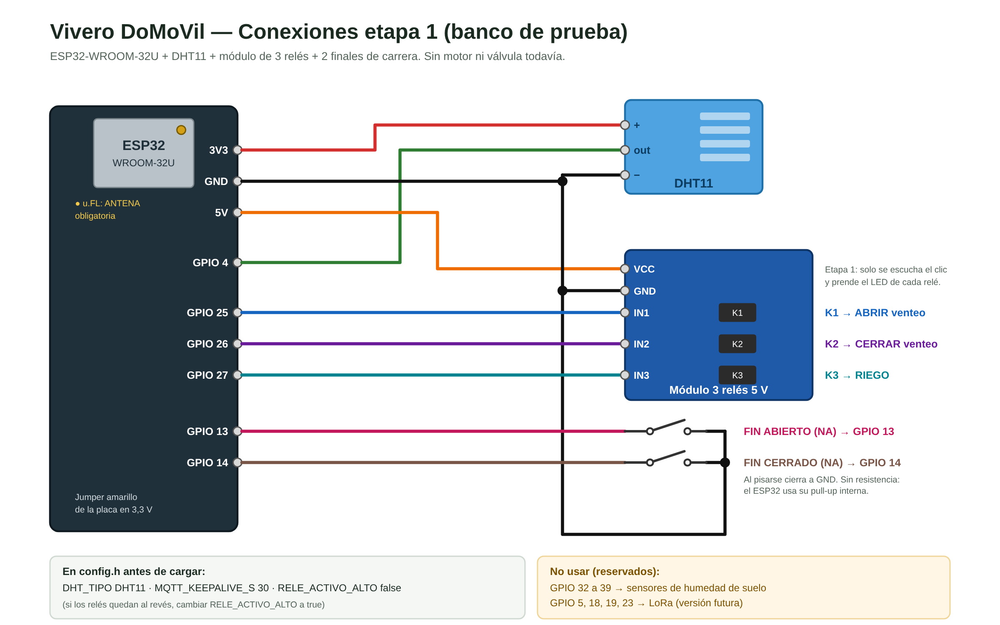
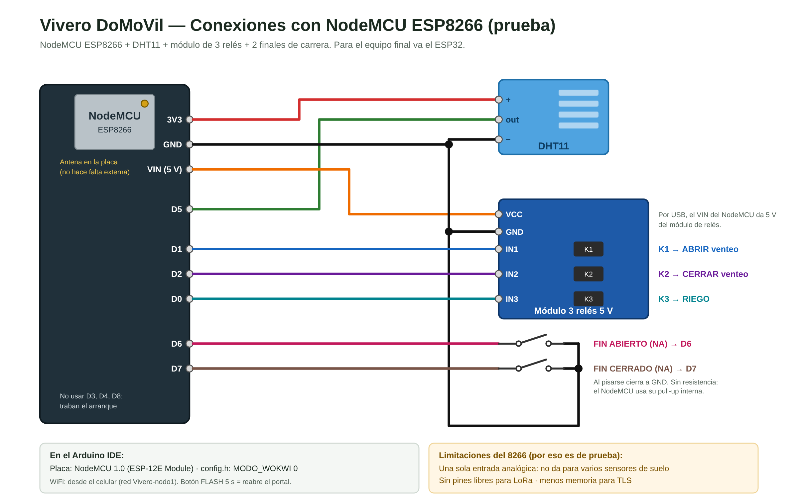

# Guía de armado — Controlador de vivero (nodo1)

Para Matías. El código ya está probado en simulación; esta guía es para armarlo en la placa real.
Se arma en **dos etapas**: primero con LEDs/relés sin carga (no se rompe nada si algo está mal), después con motor y válvula.

---

## 1. Materiales

**Etapa 1 (banco de prueba)**
- ESP32-WROOM-32U en placa de expansión (la que tenés) + **antena 2,4 GHz con conector u.FL** (sin antena casi no hay WiFi)
- Sensor DHT11 (módulo de 3 pines)
- Módulo de 3 relés (o 3 módulos de 1) de 5 V con optoacoplador, que acepte disparo de 3,3 V
- 2 microswitches con palanca (finales de carrera) o 2 pulsadores para simular
- Cables dupont, fuente para la placa (6,5–16 V por el jack, o USB)

**Etapa 2 (con carga)**
- Fuente 12 V con corriente suficiente para el motor (mirar la chapa del motor, sobredimensionar ×1,5)
- Motor DC del venteo
- 2 microswitches **por cada extremo** del venteo (ver punto 5) — o microswitches de doble contacto
- Electroválvula o bomba de riego (anotar tensión: 12 V DC, 24 VAC o 220 V)
- Fusible en la línea del motor, diodo/varistor según la carga, gabinete estanco

---

## 2. Conexiones (etapa 1)



| Elemento | Pin del ESP32 | Notas |
|---|---|---|
| DHT11 `+` | 3V3 | Jumper amarillo de la placa en **3,3 V** |
| DHT11 `out` | **GPIO 4** | |
| DHT11 `−` | GND | |
| Relé 1 — **ABRIR venteo** | **GPIO 25** | |
| Relé 2 — **CERRAR venteo** | **GPIO 26** | |
| Relé 3 — **RIEGO** | **GPIO 27** | |
| Módulo relés VCC / GND | 5V / GND | |
| Final de carrera **ABIERTO** | **GPIO 13** ↔ GND | Contacto NA: cierra a GND cuando el venteo está abierto |
| Final de carrera **CERRADO** | **GPIO 14** ↔ GND | Ídem cuando está cerrado |

**No usar** (quedan reservados): GPIO 32 a 39 (futuros sensores de humedad de suelo) y GPIO 5, 18, 19, 23 (futuro LoRa).

---

## 2 bis. Si probás con el NodeMCU ESP8266

El mismo código anda en el ESP8266: los pines se eligen solos según la placa.
Conexiones:



| Función | NodeMCU |
|---|---|
| DHT11 out | D5 |
| Relé ABRIR / CERRAR / RIEGO | D1 / D2 / D0 |
| FIN ABIERTO / FIN CERRADO | D6 / D7 |
| Relés VCC | VIN (5 V por USB) |

No usar D3, D4 ni D8 (con algo conectado, a veces la placa no arranca).
El botón para reabrir el portal es el **FLASH** de la placa.

Limitaciones (por eso el equipo final va con ESP32): una sola entrada analógica, sin pines para LoRa y poca memoria para TLS.

---

## 3. Cargar el programa

1. Instalar **Arduino IDE 2**.
2. *Archivo → Preferencias → URLs adicionales*:
   `https://espressif.github.io/arduino-esp32/package_esp32_index.json`
   Para el ESP8266 agregar también (separada por coma): `https://arduino.esp8266.com/stable/package_esp8266com_index.json`
3. *Herramientas → Placa → Gestor de placas*: instalar **esp32** (de Espressif) y/o **esp8266**.
4. *Gestor de librerías*: instalar **PubSubClient** (Nick O'Leary), **DHT sensor library** (Adafruit, acepta instalar Adafruit Unified Sensor) y **WiFiManager** (tzapu).
5. Abrir la carpeta `firmware/vivero/`.
6. Copiar `secrets.example.h` como **`secrets.h`** y completar:
   - `MQTT_PASS`: la clave del usuario `vivero-esp` (te la paso por privado, no por grupo).
   - `PORTAL_CLAVE`: una clave tuya de al menos 8 caracteres para la red del portal.
   - El WiFi **no** se pone acá: se carga desde el celular (punto 3 bis).
7. En `config.h` cambiar **una sola línea**: `#define MODO_WOKWI 0`
   (eso solo pone DHT11, keepalive 30, relés activos en bajo y activa el portal de WiFi).
   Si los relés quedan **al revés** (prendidos cuando deberían estar apagados), en `config.h` cambiar el `RELE_ACTIVO_ALTO false` por `true`.
8. Placa: **ESP32 Dev Module** (o **NodeMCU 1.0 (ESP-12E Module)** si es el 8266). Puerto: el COM que aparezca. Subir.
   Si la PC no ve la placa: falta el driver USB (**CH340** o **CP2102**, según el chip que tenga al lado del USB).
9. Abrir el **Monitor serie a 115200**. La primera vez tiene que verse:
   ```
   === Controlador de vivero nodo1 ===
   [PORTAL] sin WiFi conocido: red "Vivero-nodo1" abierta. Conectate con el celular.
   ```

## 3 bis. Cargar el WiFi con el celular (portal)

1. En el celular, ir a WiFi y conectarse a la red **Vivero-nodo1** con la `PORTAL_CLAVE` que pusiste en `secrets.h`.
2. Se abre sola una página (si no, entrar a **192.168.4.1** en el navegador).
3. Tocar **Configure WiFi**, elegir el WiFi del lugar y poner su clave.
   Abajo están los datos del broker: ya vienen cargados, **dejarlos como están** (la clave MQTT vacía = no se cambia).
4. **Save**. El ESP32 se conecta y en el monitor serie aparece:
   ```
   [WIFI] conectado, IP 192.168.x.x
   [MQTT] conectando al broker... OK
   ```
   Si dice `fallo, codigo 4` → usuario o clave del broker mal. `codigo -2` → certificado, antena o internet.

**Queda guardado**: después de un corte de luz se conecta solo. Para cambiar de WiFi (otro router, otro lugar):
- **Mantener apretado el botón BOOT de la placa 5 segundos** → vuelve a abrir el portal.
- O solo: si pasa **10 minutos sin WiFi**, abre el portal por su cuenta.
- El portal se cierra solo a los 5 minutos si nadie entra.

Mientras el portal está abierto, **la lógica sigue funcionando** (venteo y riego en automático).
Única excepción: cuando tocás Save, el ESP32 tarda hasta 10 s probando el WiFi nuevo y en ese rato no atiende el venteo.
Por eso **los finales de carrera de potencia van sí o sí en serie con el motor** (punto 5): cortan aunque el ESP32 esté ocupado.

---

## 4. Pruebas de la etapa 1 (en este orden)

Usar **MQTTX** conectado al broker y suscripto a `vivero/#`.

1. **Sensor**: cada 30 s llega `vivero/nodo1/estado` con `temp` y `hum`. Soplar o calentar el DHT y ver que cambie.
2. **Pasar a manual**: publicar `manual` en `vivero/nodo1/cmd/modo`.
3. **Riego**: `on` en `cmd/riego` → hace clic el relé 3. `off` → se suelta.
4. **Venteo abrir**: `abrir` en `cmd/venteo` → relé 1. Pisar el final **ABIERTO** → se suelta y el estado pasa a `abierto`.
5. **Venteo cerrar**: `cerrar` → relé 2. Pisar **CERRADO** → se suelta, estado `cerrado`.
6. **Protección de tiempo**: `abrir` y **no** pisar nada → a los 60 s se corta solo y llega una alarma. El estado queda `error`; se sale con otro `abrir` o `cerrar` en manual.
7. **Automático**: `auto` en `cmd/modo`. Calentar el DHT por encima de 28 °C → abre. Bajar de 24 °C → cierra.
8. **Corte de luz**: desenchufar y enchufar → tiene que volver en el mismo modo y con los mismos setpoints.
9. **Sin internet**: apagar el router → la lógica automática sigue funcionando (mirar los relés), y al volver se reconecta solo.

Si todo esto anda, recién ahí etapa 2.

---

## 5. Etapa 2 — potencia y seguridad (importante)

**Puente con 2 relés para el motor DC** (relés inversores, con COM / NA / NC):
```
            +12V                     +12V
              │                        │
      [FC abierto NC]          [FC cerrado NC]
              │                        │
   Relé ABRIR: NA            Relé CERRAR: NA
              COM ─── MOTOR ─── COM
   Relé ABRIR: NC            Relé CERRAR: NC
              │                        │
             GND                      GND
```
- Con los dos relés sueltos, los dos bornes del motor quedan a GND → motor parado (y frenado).
- Si por un error se activan los dos a la vez, los dos bornes quedan a +12 V → **no hay cortocircuito**. Por eso este armado es seguro.
- Los **finales de carrera de potencia** (NC, en serie con el NA de cada relé) cortan el motor **aunque el ESP32 se cuelgue**.
  El ESP32 necesita además *otro* contacto para leer el final de carrera (por eso 2 switches por extremo, o uno de doble contacto).
  No se puede usar el mismo contacto: uno está en 12 V y el otro va a 3,3 V del ESP32.
- Verificar que la corriente del motor (sobre todo la de arranque) no supere la de los contactos del relé y de los microswitches. Si la supera: contactor o driver (BTS7960).
- Fusible en la línea de +12 V del motor.

**Riego**
- Electroválvula de 12 V DC: diodo en antiparalelo sobre la bobina.
- 24 VAC o 220 V: relé con contactos adecuados y varistor/snubber sobre la bobina. 220 V siempre en gabinete y con térmica.

**Ruido**: separar los cables de potencia de los de señal (sensor y finales de carrera). Si los finales de carrera quedan a más de 2–3 m, conviene un capacitor de 100 nF entre el pin y GND.

---

## 6. Valores que se pueden cambiar sin reprogramar

Publicando en `vivero/nodo1/cmd/config/<clave>` (quedan guardados en el ESP32):

| Clave | Por defecto | Qué hace |
|---|---|---|
| `temp_abrir` | 28 °C | Abre el venteo |
| `temp_cerrar` | 24 °C | Cierra el venteo |
| `hum_riego_on` | 40 % | Empieza a regar |
| `hum_riego_off` | 60 % | Deja de regar |
| `motor_max_s` | 60 s | Tiempo máximo de recorrido del venteo — **medir el recorrido real y poner un 30 % más** |
| `riego_max_min` | 10 min | Corte de seguridad del riego |
| `riego_pausa_min` | 30 min | Pausa mínima entre riegos automáticos |

> **Ojo:** por ahora el riego automático usa la **humedad del aire** (DHT11). Es provisorio: para regar bien hace falta el sensor capacitivo de humedad de suelo (va en GPIO 32–39).
