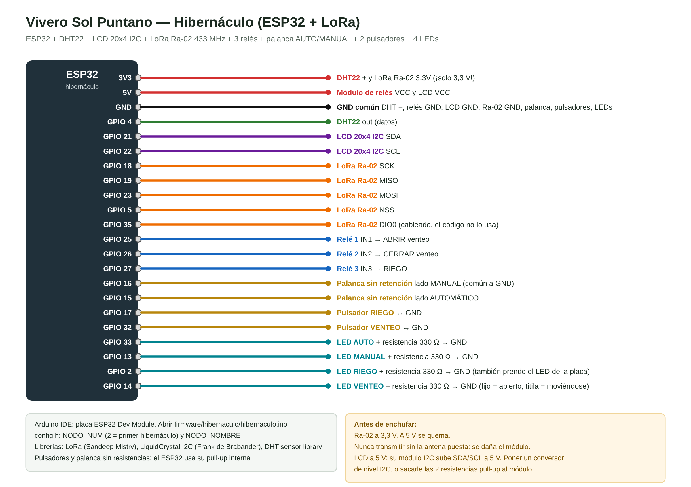
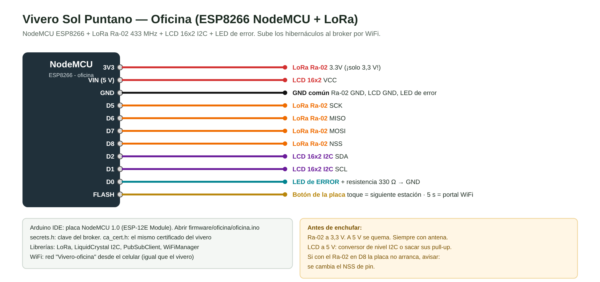

# Guía de armado — Hibernáculo con LoRa + estación de oficina

```
 HIBERNÁCULO (ESP32)  ── LoRa 433 MHz ──►  OFICINA (NodeMCU 8266)  ── WiFi ──►  Broker MQTT  ◄──  App
 sensor, relés, pantalla,                  pantalla, LED de error,
 palanca, pulsadores, LEDs                 botón FLASH
```
- El hibernáculo **no usa WiFi**: funciona solo y le cuenta todo a la oficina por radio.
- La oficina lo sube al broker como `vivero/nodo2/...` (el vivero es `nodo1`). En la app aparece arriba una ficha por equipo.
- Se pueden sumar más hibernáculos: cada uno con su `NODO_NUM` (2, 3, 4...). La oficina los reconoce solos.

---

## 1. Materiales

**Hibernáculo**
- ESP32 (el mismo tipo que el del vivero)
- DHT22 (AM2302)
- LCD 20x4 con módulo I2C
- LoRa **Ra-02 (SX1278) 433 MHz** + **antena de 433 MHz** (conector IPEX)
- Módulo de 3 relés 5 V
- Actuador lineal **con finales de carrera internos** para el venteo
- Palanca **sin retención** de 3 posiciones (ON)-OFF-(ON) para AUTO/MANUAL
- 2 pulsadores (RIEGO, VENTEO) · 4 LEDs + 4 resistencias de 330 Ω
- Conversor de nivel I2C 5 V ↔ 3,3 V (para la pantalla, ver aviso)

**Oficina**
- NodeMCU ESP8266
- LoRa **Ra-02 433 MHz** + antena (**igual** que el del hibernáculo)
- LCD 16x2 con módulo I2C (+ conversor de nivel)
- 1 LED + 1 resistencia de 330 Ω

## ⚠ Antes de enchufar
- **El Ra-02 va a 3,3 V.** A 5 V se quema.
- **Nunca transmitir sin la antena puesta**: el módulo se daña.
- **Pantallas LCD con módulo I2C:** van a 5 V y su módulo sube las líneas SDA/SCL a 5 V; el ESP32 y el 8266 son de 3,3 V. Poner un **conversor de nivel I2C** entre la pantalla y la placa, o sacarle al módulo de la pantalla sus 2 resistencias pull-up.

---

## 2. Conexiones

**Hibernáculo:** 

**Oficina:** 

---

## 3. Cargar los programas

Librerías (Gestor de librerías): **LoRa** (Sandeep Mistry), **LiquidCrystal I2C** (Frank de Brabander), **DHT sensor library** (Adafruit) y, para la oficina, también **PubSubClient** y **WiFiManager**.

**Hibernáculo** — abrir `firmware/hibernaculo/hibernaculo.ino`
1. `config.h`: `NODO_NUM 2` y `NODO_NOMBRE "Hibernaculo 1"` (sin tildes: la pantalla no las muestra).
2. Placa **ESP32 Dev Module** → Subir.
3. Monitor serie 115200: `=== Hibernaculo - estacion 2 ===` y `[LORA] listo`.
   Si dice `[LORA] NO RESPONDE` → revisar SCK/MISO/MOSI/NSS y los 3,3 V del Ra-02.

**Oficina** — abrir `firmware/oficina/oficina.ino`
1. Copiar `secrets.example.h` como `secrets.h` y poner la clave del broker.
2. `ca_cert.h`: pegar el mismo certificado que en el vivero.
3. Placa **NodeMCU 1.0 (ESP-12E Module)** → Subir.
4. Con el celular, conectarse a la red **Vivero-oficina** y cargar el WiFi (como en el vivero).
5. Monitor serie: `[LORA] listo`, `[WIFI] conectado`, `[MQTT] conectando al broker... OK`.

> `protocolo.h` tiene que ser **igual** en las dos carpetas (frecuencia, palabra de red, etc.).

---

## 4. Cómo se usa

**Hibernáculo**
| Mando | Qué hace |
|---|---|
| Palanca → MANUAL | pasa a manual (si ya estaba, no hace nada) |
| Palanca → AUTOMÁTICO | pasa a automático |
| Pulsador RIEGO (manual) | prende / apaga el riego |
| Pulsador VENTEO (manual) | cerrado → abre · abierto → cierra · moviéndose → para |

En automático RIEGO y VENTEO no hacen nada (y llega una alarma a la app). En manual se puede manejar **desde la caja o desde la app**: vale la última orden, y los LEDs muestran siempre el estado real.

| LED | Significa |
|---|---|
| AUTO / MANUAL | el modo actual |
| RIEGO | prendido = regando |
| VENTEO | fijo = abierto · titila = moviéndose |

**Venteo por tiempo:** para abrir, el relé ABRIR queda prendido el "tiempo de recorrido" y se corta. **Medir cuánto tarda el actuador de punta a punta y ponerle un 20 % más** (app → Ajustes → *Tiempo de recorrido del actuador*). Al arrancar, el hibernáculo **cierra** el venteo para saber dónde está.

**Pantalla del hibernáculo (20x4)**
```
AUTOMATICO 23.4C 81%
Venteo: CERRADO
Riego:  APAGADO
Est.2  -87dBm
```

**Oficina**
- **Botón FLASH:** cada toque pasa a la estación siguiente (la página 0 es la oficina: WiFi, MQTT, cantidad de estaciones). Mantenerlo 5 s abre el portal de WiFi.
- **LED de error:** prendido si **alguna** estación tiene problema: sin señal LoRa por más de 1 minuto, sensor caído o error de venteo. Ir pasando con el botón hasta la que dice `ERROR: ...`.
- La pantalla pasa sola de estación cada 8 s, **menos** cuando está mostrando una con error.

---

## 5. Primera prueba de radio (en el banco, los dos equipos juntos)
1. Prender los dos con antena.
2. En el monitor serie de la oficina tienen que aparecer cada ~20 s líneas `[LORA] <- SP|S|2|...` con la señal (`-40 dBm` de cerca está bien).
3. En la app, arriba, aparece la ficha **Hibernaculo 1**. Tocarla: se ven temperatura y humedad.
4. Desde la app: Manual → Regar. En el hibernáculo hace clic el relé 3 y prende el LED RIEGO; en el monitor de la oficina sale `[ORDEN] confirmada`.
5. Apagar el hibernáculo: al minuto se prende el LED de error de la oficina y la pantalla muestra `ERROR: SIN SENAL`.

Después probar la distancia real: llevar el hibernáculo a su lugar y mirar la señal (dBm) en la pantalla de la oficina. Hasta unos `-110 dBm` anda; más bajo, mejorar la antena o subirla.

---

## 6. Lo que todavía no se probó
El código de los dos equipos **compila**, pero la parte de **radio LoRa no se pudo simular** (Wokwi no tiene LoRa). La primera prueba real es la del punto 5: si algo falla, pasar lo que muestran los dos monitores serie.
